# Nebula9 Enterprise Knowledge Intelligence Reference Platform

[](file:///backend/tests/)
[](file:///backend/evaluation_report.md)
[](file:///frontend/)
[](file:///Documents/Nebula9_Agent_Orchestration_Flowchart.png)

> **Enterprise Knowledge Intelligence:** Turn fragmented enterprise knowledge into trusted, contextual answers that support faster research and better-informed decisions. Backed by mathematical grounding verification, autonomous conflict detection, safe read-only SQL sandboxing, and strict enterprise security guardrails.

---

## 1. Platform Architecture

The platform implements an **intent-driven, 9-stage modular multi-agent orchestration pipeline**:

```mermaid
flowchart LR
    UQ["User Query"] --> QU["1. Query Understanding"]
    QU --> IC["2. Intent Classification"]
    IC --> QR["3. Query Routing"]
    QR --> IP["4. Investigation Planning"]
    IP --> PR["5. Parallel Retrieval\n(SQL Sandbox & Hybrid Docs)"]
    PR --> EE["6. Evidence Extraction"]
    EE --> SM["7. Summarization"]
    SM --> TV["8. Traceability & Trust Gate\n(Grounding & Conflicts)"]
    TV --> SY["9. Response Synthesis\n(Executive Briefing)"]
```



### Key Architectural Capabilities:
- **Heterogeneous Retrieval**: Parallel execution across relational SQLite/PostgreSQL telemetry and unstructured hybrid document vector stores (PDFs, Excel spreadsheets, SOPs).
- **Safe SQL Sandbox**: AST-validated, read-only query execution with strict schema allowlists and parameterization (blocking `DROP`, `DELETE`, `INSERT`, `UPDATE`).
- **Evidence & Trust Gate (`validation_agent.py`)**: Computes mathematical grounding scores ($0.0 \dots 1.0$), classifies `VERIFIED_FACT` vs `ANALYTICAL_INFERENCE`, and autonomously flags operational conflicts (e.g. `CONF-01`, `CONF-02`, `CONF-03`).
- **Zero-Hallucination Safe Abstention**: Explicitly refuses to guess when inquiries target unindexed facilities or topics.
- **Enterprise AI Threat Guardrails (`guardrails.py`)**: Intercepts direct prompt injections, jailbreaks, and credential harvesting attempts.
- **Persistent Governance Ledger (`audit.py`)**: Immutable, write-ahead audit event logging capturing actor, timestamp, task graph, accessed tables, latency, and grounding metrics.

---

## 2. Quickstart & Local Setup

### Prerequisites
- **Python**: 3.11+ (tested on Python 3.13)
- **Node.js**: v18+ or v20+ with npm

### Step 1: Backend Setup
```bash
cd backend
python -m venv venv
# Windows:
.\venv\Scripts\activate
# Linux/macOS:
# source venv/bin/activate

pip install -r requirements.txt
python -c "from app.db.seeder import seed_database; seed_database()"
python -m uvicorn app.main:app --reload --port 8000
```
*Health verification*: Open `http://localhost:8000/api/health` $\rightarrow$ `{"status": "healthy"}`.

### Step 2: Frontend Setup
```bash
cd frontend
npm install
npm run dev
```
*Access UI*: Open your browser at `http://localhost:5173`.

---

## 3. Seeded Enterprise Demo Accounts (RBAC)

The platform comes pre-seeded with 4 distinct enterprise personas:

| Persona | Username | Password | Role Clearance & Responsibilities |
| :--- | :--- | :--- | :--- |
| **Chief Operating Officer** | `cxo_exec` | `Executive2026!` | Full cross-source synthesis, executive KPIs, and evidence inspection. |
| **Enterprise Auditor** | `auditor_dan` | `Auditor2026!` | Read-only governance ledger, forensic audit logs, and benchmark evaluation runs. |
| **Quality & Regulatory Lead** | `qa_analyst` | `Quality2026!` | Life sciences clinical trials, adverse event reporting, and cGMP batch release. |
| **Shop-Floor Line Operator** | `operator_line3` | `Operator2026!` | Local operational telemetry; restricted from administrative and cross-industry endpoints. |

---

## 4. Multi-Industry Configuration Packs

The platform demonstrates **true zero-code multi-industry portability**. All domain entities, terminology, sources, scenarios, and prompts are defined declaratively in YAML under [`config/industries/`](file:///config/industries/):

1. **Manufacturing & Industrial (`manufacturing`)**:
   - *Scenarios*: Plant A assembly downtime, hydraulic seal wear recurrence, and supplier component defect rates.
   - *Sources*: `plant_downtime_events`, `maintenance_work_orders`, `supplier_component_quality`, `SOP-MN-014.pdf`, `Supplier_Defects_Q1.xlsx`.
   - *Conflict Detected*: `CONF-01` (Maintenance sign-off on March 10 vs unscheduled stoppage on March 14).

2. **Pharmaceutical & Life Sciences (`pharma`)**:
   - *Scenarios*: CardioVastin Phase 3 trial efficacy, FDA 15-day expedited adverse event reporting, and Lot 4891 cGMP cleanroom batch release.
   - *Sources*: `clinical_trial_metrics`, `adverse_event_reports`, `pharma_batch_quality`, `Clinical_Trial_Protocol_CardioVastin_PH3.pdf`, `FDA_Regulatory_Approval_Summary.pdf`, `SOP-PV-042.pdf`, `Quality_Batch_Release_SOP.pdf`.
   - *Conflict Detected*: `CONF-03` (Adverse event reporting latencies exceeding FDA 21 CFR 314.80 15-day deadlines).

### How to Add a New Industry in < 1 Hour ("Plug & Play"):
1. Create a new folder under `config/industries/<new_industry>/`.
2. Define `industry.yaml`, `terminology.yaml`, `sources.yaml`, `scenarios.yaml`, and `prompts.yaml`.
3. Drop unstructured files (PDFs, Excel) into `data/unstructured/`.
4. Register any structured tables in `models.py` and allowlist them in `sql_sandbox.py`.
5. Switch active industry via UI or `POST /api/config/active` without changing core orchestration logic!

---

## 5. Quantitative Evaluation & Quality Benchmark (PRD §26)

The platform includes an automated evaluation suite of **30 curated gold-standard benchmark questions** spanning both industries:

| Metric | Manufacturing Benchmark | Pharma Benchmark | Target Threshold | Status |
| :--- | :---: | :---: | :---: | :---: |
| **Overall Pass Rate** | **100.0%** (15/15) | **100.0%** (15/15) | $\ge 90.0\%$ | **PASSED** |
| **Factual Grounding Score** | **100%** | **92%** | $\ge 85.0\%$ | **PASSED** |
| **Operational Conflict Accuracy** | **100.0%** | **100.0%** | $100.0\%$ | **PASSED** |
| **Safe Abstention F1 Accuracy** | **100.0%** | **100.0%** | $100.0\%$ | **PASSED** |
| **Security Interception Rate** | **100.0%** | **100.0%** | $100.0\%$ | **PASSED** |
| **Median Response Latency** | **3 ms** | **4 ms** | $< 500\text{ ms}$ | **PASSED** |

To run the benchmark suite from CLI:
```bash
cd backend
python -m app.evaluation.runner --industry all
```
*Outputs generated*: [`backend/evaluation_report.json`](file:///backend/evaluation_report.json) and [`backend/evaluation_report.md`](file:///backend/evaluation_report.md).

---

## 6. Running Tests

```bash
cd backend
python -m pytest tests/ -v
```
All **109 tests** across unit, integration, AST sandbox security, multi-agent orchestration, and benchmark evaluations pass cleanly.

---

## 7. Demo Video Script & Runbook

For presentation walk-throughs, refer to [`DEMO_VIDEO_SCRIPT.md`](file:///DEMO_VIDEO_SCRIPT.md) for a time-coded 6–8 minute narrative script covering all 9 scenes from login to benchmark execution.
